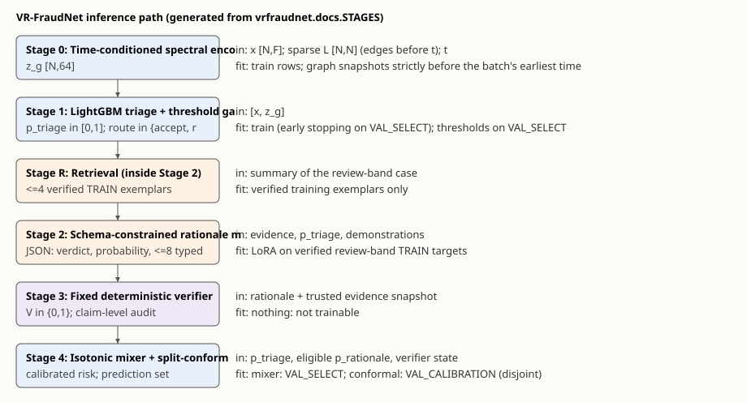

# Architecture

Original diagram, generated from the stage specification in `src/vrfraudnet/docs.py` by `vrfraudnet docs`, so it cannot drift from the code.

## Stages: inputs, outputs, fitting, failure policy

| Stage | Module | Input | Output | Fitted on | Failure policy |
|---|---|---|---|---|---|
| 0 Time-conditioned spectral encoder | `models/spectral.py` | x [N,F]; sparse L [N,N] (edges before t); t | z_g [N,64] | train rows; graph snapshots strictly before the batch's earliest time | no graph: bypassed (past-only tabular features) |
| 1 LightGBM triage + threshold gate | `models/triage.py` | [x, z_g] | p_triage in [0,1]; route in {accept, reject, escalate} | train (early stopping on VAL_SELECT); thresholds on VAL_SELECT | band is inclusive: T_low <= p <= T_high escalates |
| R Retrieval (inside Stage 2) | `retrieval/index.py` | summary of the review-band case | <=4 verified TRAIN exemplars | verified training exemplars only | fewer or none is valid; never back-filled |
| 2 Schema-constrained rationale model | `models/rationale.py, models/grammar.py` | evidence, p_triage, demonstrations | JSON: verdict, probability, <=8 typed claims, evidence_refs | LoRA on verified review-band TRAIN targets | token limit / parse failure => treated as verification failure |
| 3 Fixed deterministic verifier | `verifier/` | rationale + trusted evidence snapshot | V in {0,1}; claim-level audit | nothing: not trainable | unknown evidence is 'unverifiable', never 'absent'; rejection => human review |
| 4 Isotonic mixer + split-conformal | `models/mixer.py, calibration/conformal.py` | p_triage, eligible p_rationale, verifier state | calibrated risk; prediction set | mixer: VAL_SELECT; conformal: VAL_CALIBRATION (disjoint) | rejected rationale probability is never read |

## Following one transaction

1. Stage 0 turns the past-only graph around the transaction into a 64-d embedding (bypassed if no graph exists).
2. Stage 1 scores it. `p < T_low` accepts, `p > T_high` rejects, `T_low <= p <= T_high` escalates (inclusive band, Sec. 3.8.1, D-01).
3. Only escalated cases reach Stage 2, which emits compact JSON under a grammar mask: verdict, probability, at most 8 typed claims, evidence references.
4. Stage 3 checks each claim against the trusted evidence snapshot with five typed primitives (numeric comparison, set membership, temporal relation, graph path, entity match), then cross-claim and verdict consistency. Per claim: supported / contradicted / unverifiable. Unknown is never treated as absent.
5. Stage 4 mixes. Verifier state is NOT_INVOKED, ACCEPTED or REJECTED and survives serialization. A rejected rationale's probability is never read (perturbation-tested). A missing probability is NaN, never 0.0. A split-conformal set is attached.

`vrfraudnet demo` prints this walk on the synthetic fixture; `vrfraudnet verify RATIONALE EVIDENCE` prints the claim-level audit for any pair.

## Equations to source

| Paper element | Source |
|---|---|
| Eq. 5 routing rule (as stated in Sec. 3.8.1) | `models/triage.py::route_probability` |
| Class-balanced focal surrogate | `models/triage.py::focal_loss`, `focal_grad_hess`, `class_balanced_alpha` |
| Cost-sensitive weights (Sec. 3.6.1) | `models/triage.py::cost_sample_weights` (D-06) |
| Beta-kernel spectral filters, time embedding | `models/spectral.py::SpectralEncoder`, `TimeEmbedding` |
| Grammar-masked greedy decoding | `models/grammar.py` |
| Verifier primitives and consistency | `verifier/primitives.py`, `verifier/engine.py` |
| Isotonic mixer | `models/mixer.py` (D-04) |
| Split-conformal, drift-weighted variant | `calibration/conformal.py` (D-07) |
| Counterfactual stability loss | `training/objectives.py` (D-14) |
| AUPRC, Recall@top-1%, ECE, DI | `evaluation/metrics.py`, `evaluation/cost.py` |
| Wilcoxon, Holm | `evaluation/stats.py` |

## Fitting order and leakage controls

Encoder, then triage, then retrieval index (train only), then rationale LoRA (verified train targets), then mixer (VAL_SELECT), then conformal (VAL_CALIBRATION, disjoint). Validation is halved chronologically. Transformers are fit on train only, target encoding is out-of-fold, graph snapshots use edges strictly before the prediction time, retrieval filters eligibility before top-k, and the F1 threshold is frozen from VAL_SELECT. Stage commands: `prepare, train-encoder, train-triage, build-index, train-rationale, fit-mixer, calibrate, predict, evaluate`.
